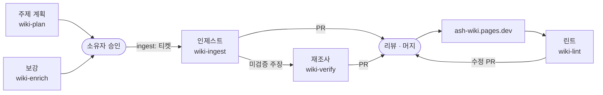

<div align="center">

# Æ wiki

**자동차 임베디드 지식을 공개 출처로 검증해 한국어로 게시하는 위키**

[](docs/engine.md)
[](https://ash-wiki.pages.dev)

[사이트](https://ash-wiki.pages.dev) · [작동 방식](#작동-방식) · [로컬 개발](#로컬-개발) · [문서](#문서) · [라이선스](#라이선스)

</div>

LLM이 쓰고 관리하되, 모든 주장을 공개 출처로 검증해 인용하는 위키입니다. Andrej Karpathy의 [LLM wiki](https://gist.github.com/karpathy/442a6bf555914893e9891c11519de94f) 패턴에 위키백과의 검증 가능성 원칙을 더했습니다.

## 특징

- **주장 단위 검증**: 주장마다 종류(규범·동작·배경·이론)에 맞는 1층 출처로 판정합니다. 검증된 주장만 게시하고, 미검증 주장은 `verify:` 이슈에서 한 번 더 조사합니다.
- **번호 인용**: 본문의 `[@키]`를 IEEE 스타일 번호로 바꾸고, 페이지 끝에 참고문헌을 붙입니다.
- **하네스**: 표기는 콘텐츠 검사기(CI), 문장의 정확성은 리뷰, 주제 전체의 일관성은 린트가 봅니다. 규칙마다 정본 문서는 하나입니다.
- **회고**: 세션 기록에서 반복된 문제를 찾아 스킬과 문서를 고치는 티켓을 만듭니다.

## 다루는 주제

| 구역              | 주제                                              |
| ----------------- | ------------------------------------------------- |
| 네트워크          | CAN, Ethernet, TCP/IP, 진단                       |
| 소프트웨어 플랫폼 | AUTOSAR, RTOS                                     |
| 보안·업데이트     | OTA, 사이버보안, 암호                             |
| 소프트웨어 공학   | 소프트웨어 프로세스, 소프트웨어 테스트, 기능 안전 |

2026년 10월 기준 350여 쪽, 도해 430여 개, 참고문헌 1,500여 개입니다. 검증을 거치지 않는 [주간 소식](docs/weekly-news.md)은 위키 콘텐츠와 따로 둡니다.

## 작동 방식

모든 변경은 PR로 들어오고, 머지는 사람이 합니다. 콘텐츠는 Claude Code 스킬(`.claude/skills/`)로 만듭니다.



| 스킬             | 하는 일                                                    |
| ---------------- | ---------------------------------------------------------- |
| `wiki-plan`      | 소스 노트에 따른 페이지 묶음 계획과 `ingest:` 티켓 발행    |
| `wiki-enrich`    | 공개 출처만으로 주제를 넓히는 보강 계획                    |
| `wiki-ingest`    | 묶음 하나의 초안, 검증, 도해, 격리 자기 점검과 PR          |
| `wiki-verify`    | `verify:` 이슈의 미검증 주장 재조사(한 번만)               |
| `wiki-lint`      | 주제나 구역 전체의 모순, 중복, 용어 불일치, 낡은 출처 점검 |
| `wiki-retro`     | 세션 기록으로부터 스킬 개선점 도출                         |
| `reader-testing` | 규칙을 모르는 독자 시점에서 오독되는 문장 찾기             |
| `wiki-news`      | 주간 업계 소식 정리                                        |

판정 기준은 [검증 절차](docs/wiki-verification.md)와 [출처 위계](docs/source-hierarchy.md)에, 결정 배경은 [ADR](docs/adr/)에 있습니다.

## 로컬 개발

### 요구 사항

- Node.js 22.19 이상 또는 24.5 이상(`.node-version`은 22)
- npm 10.9.2 이상
- 스킬을 쓰려면 [Claude Code](https://claude.com/claude-code), [mattpocock-skills](https://github.com/mattpocock/skills) 플러그인, `gh` CLI

### 로컬 프리뷰

```sh
npm ci
npm run prebuild
npx quartz build --serve
```

`http://localhost:8080`에서 대문이 열립니다. `prebuild`는 전체 커밋 기록, 플러그인, 참고문헌 합본, OG 이미지 폰트를 준비합니다.

> [!TIP]
> `npm run preview:diff`는 `origin/main` 이후 바뀐 블록을 표시합니다. 기준은 `WIKI_DIFF=<SHA>`로 바꿉니다. 자세한 내용은 [배포 문서](docs/deploy.md#바뀐-곳-표시)에 있습니다.

### 검사

```sh
npm run check
```

CI와 같은 검사(prettier, 타입 검사, 콘텐츠 검사기, 테스트)입니다. PR을 올리기 전에 통과시킵니다.

## 저장소 구조

```
content/          위키 페이지, 도해(diagrams/), 주간 소식(news/)
bib/              참고문헌(항목마다 파일 하나, 빌드 전에 합침)
docs/             운영 문서와 ADR
tools/            콘텐츠 검사기, 참고문헌 합본, 출처 상태 수집 등
plugins/          직접 만든 Quartz 플러그인
quartz/           Quartz v5 엔진(고친 이유는 각 파일의 주석)
.claude/skills/   위키 스킬
GLOSSARY.md       운영 용어집
```

## 문서

| 문서                                             | 내용                                |
| ------------------------------------------------ | ----------------------------------- |
| [GLOSSARY.md](GLOSSARY.md)                       | 운영 용어집                         |
| [위키 규약](docs/wiki-conventions.md)            | 페이지 표기 규칙과 콘텐츠 검사기    |
| [용어 표기 결정](docs/wiki-terms.md)             | 표기가 갈린 콘텐츠 용어의 결정      |
| [풀이하지 않는 약어](docs/wiki-abbreviations.md) | 풀이 없이 쓰는 약어 목록            |
| [검증 절차](docs/wiki-verification.md)           | 주장 판정과 재조사                  |
| [출처 위계](docs/source-hierarchy.md)            | 주장 종류별 1층 출처                |
| [엔진](docs/engine.md)                           | Quartz 기준선과 설정                |
| [배포](docs/deploy.md)                           | Cloudflare Pages 설정과 로컬 프리뷰 |
| [팔레트](docs/palette.md)                        | 색, 폰트, 도해 팔레트와 대비 실측   |
| [주간 소식](docs/weekly-news.md)                 | 주간 소식 형식                      |
| [ADR](docs/adr/)                                 | 되돌리기 어려운 결정의 기록         |
| [CONTRIBUTING.md](CONTRIBUTING.md)               | 브랜치, PR, 리뷰, 이슈 규칙         |

## 라이선스

| 범위                                                   | 경로                    | 라이선스                         |
| ------------------------------------------------------ | ----------------------- | -------------------------------- |
| 코드: 엔진, 로컬 플러그인, 도구, 설정, 스킬, 운영 문서 | 아래 행 밖의 모든 파일  | [MIT](LICENSE-MIT)               |
| 콘텐츠: 위키 페이지, 도해, 주간 소식, 태그 페이지      | `content/`              | [CC BY 4.0](LICENSE-CC-BY-4.0)   |
| 참고문헌 데이터(엔트리마다 하나인 `.bib` 파일)         | `bib/`                  | [CC0 1.0](LICENSE-CC0-1.0)       |
| IEEE CSL 스타일                                        | `csl/ieee.csl`          | CC BY-SA 3.0(파일 안 `<rights>`) |
| giscus 테마 CSS                                        | `quartz/static/giscus/` | MIT(GitHub, 파일 머리 주석)      |

상표와 로고, 주간 소식이 링크한 원문 이미지와 제목은 각 권리자의 것입니다.
